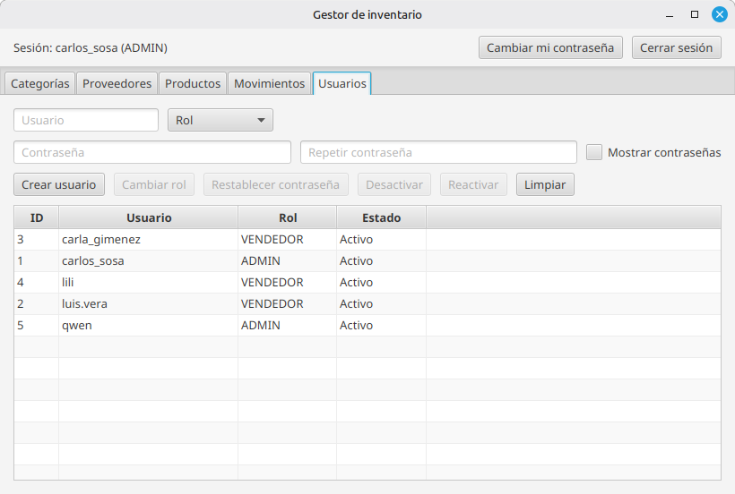

# Gestor de inventario

Aplicación de escritorio para controlar el inventario de una tienda pequeña: productos con categoría y proveedor, un historial de movimientos (entradas, salidas y ajustes) que mantiene el stock, alertas de stock bajo, e inicio de sesión con roles y gestión de usuarios.

> **Estado:** en desarrollo. Ver [Hoja de ruta](#hoja-de-ruta).




## Tecnologías

- **Java 21** y **JavaFX 21** (interfaz gráfica)
- **SQLite** con sqlite-jdbc
- **Maven**
- **BCrypt** (at.favre.lib) para las contraseñas

## Funcionalidades

- **Catálogo:** categorías, proveedores (con teléfono opcional) y productos con precio y stock mínimo.
- **Nombres sin duplicados:** "Lácteos", "LACTEOS" y "lacteos" se consideran el mismo nombre. Se guarda una clave normalizada (sin mayúsculas, tildes ni espacios de más) con un índice único, conservando la ñ como letra propia ("Peña" ≠ "Pena").
- **Movimientos de stock:** entradas, salidas y ajustes por conteo físico. El stock solo cambia a través de movimientos.
- **Kardex:** cada movimiento guarda el stock anterior y el resultante.
- **Alertas de stock bajo:** filas resaltadas y contador en la pantalla de productos; resumen en vivo antes de registrar un movimiento.
- **Usuarios y roles:** inicio de sesión, roles ADMIN y VENDEDOR, gestión de usuarios (crear, cambiar rol, desactivar y restablecer contraseña), cambio de la propia contraseña y cierre de sesión.

## Decisiones de diseño

### Arquitectura por capas (MVC)

```
com.inventario
├── modelo        Entidades, reglas de validación y permisos
├── dao           Acceso a datos (SQL)
├── vista         Pantallas JavaFX, sin lógica de datos
├── controlador   Conecta cada vista con sus DAO
└── util          Validaciones y manejo de contraseñas
```

Regla de dependencias: la vista conoce al modelo pero nunca a los DAO; el controlador conoce vista, DAO y modelo; el DAO conoce al modelo.

### Integridad de los datos

- Todo el SQL usa `PreparedStatement`.
- Las operaciones que tocan varias tablas usan una sola transacción con `commit` y `rollback`.
- **Salidas:** `UPDATE ... WHERE stock_actual >= ? RETURNING stock_actual`. La base rechaza una salida sin stock suficiente, y el stock resultante se obtiene en la misma sentencia que lo modifica.
- **Ajustes:** se informa el stock contado y la diferencia se calcula dentro de la transacción, con bloqueo optimista (`WHERE stock_actual = ?`) para detectar si el stock cambió mientras se contaba.
- **Topes:** cada movimiento admite hasta 1.000.000 unidades y el stock total no puede superar 1.000.000.000, para que nunca se desborde un entero.
- **Migraciones:** al iniciar, la aplicación agrega las columnas que falten (`ALTER TABLE`) para actualizar bases existentes sin perder datos.

El kardex se puede auditar con una consulta. Si devuelve filas, hay movimientos inconsistentes:

```sql
SELECT * FROM movimientos
WHERE stock_resultante - stock_anterior <>
      CASE tipo WHEN 'SALIDA' THEN -cantidad ELSE cantidad END;
```

### Seguridad

- **Contraseñas con BCrypt** (costo 12): se guarda solo un hash lento con sal aleatoria, nunca la contraseña.
- **Sin credenciales por defecto:** el primer administrador se crea en la primera ejecución; no existe un `admin/admin`.
- **Login sin filtraciones:** el mismo mensaje y el mismo tiempo de respuesta para todos los fallos, así no se puede saber qué usuarios existen.
- **Reglas de contraseña según NIST:** mínimo 8 caracteres, sin exigir símbolos; máximo 72 bytes por el límite de BCrypt.
- **Bloqueo temporal:** 5 intentos fallidos bloquean la cuenta 5 minutos.
- **Registro de accesos:** cada intento de inicio de sesión queda auditado, nunca con la contraseña. Si no se puede registrar, no se entra.
- **Control de acceso por rol:** los permisos se definen en un solo lugar (`Usuario`) y se comprueban en los controladores, no solo ocultando botones. Las pantallas sin permiso ni siquiera se crean.
- **Cambio obligatorio:** cuando un administrador crea o restablece una contraseña, el usuario debe cambiarla en su siguiente inicio de sesión.
- **Cambio de la propia contraseña:** exige la contraseña actual.
- **Borrado seguro:** SQLite sobrescribe con ceros lo que se borra o reemplaza (por ejemplo, hashes de contraseñas anteriores).
- **El hash no sale de la capa de datos:** el modelo `Usuario` no lo contiene.

**Alcance (modelo de amenazas):** el login protege los flujos de la aplicación. Quien tenga acceso directo al archivo `inventario.db` puede leerlo o modificarlo con otras herramientas; protegerlo por completo requeriría una arquitectura cliente-servidor.

## Cómo ejecutarlo

Requisitos: JDK 21 y Maven.

```bash
git clone <url-del-repositorio>
cd inventario-app
mvn clean javafx:run
```

La base de datos `inventario.db` se crea en la carpeta del proyecto. En la primera ejecución, la aplicación pide crear la cuenta de administrador.

## Hoja de ruta

- [x] Catálogo de categorías, proveedores y productos
- [x] Movimientos con transacciones y kardex
- [x] Inicio de sesión con BCrypt
- [x] Roles ADMIN y VENDEDOR
- [x] Bloqueo temporal tras intentos fallidos
- [x] Gestión de usuarios
- [ ] Auditoría de acciones de administrador
- [ ] Búsqueda y filtros
- [ ] Reportes en PDF y exportación a CSV
- [ ] Pruebas con JUnit y registro de errores
- [ ] Instaladores para Linux y Windows